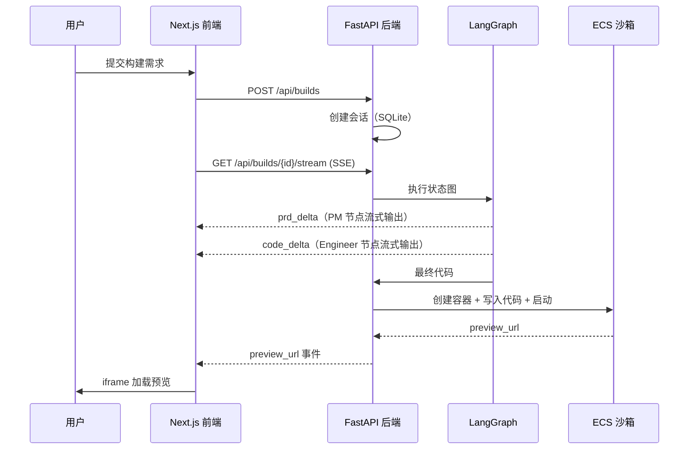

# 全栈架构设计：AI 应用构建平台（Atoms 复刻）

<div align="center">

[](https://nextjs.org/)
[](https://fastapi.tiangolo.com/)
[](https://www.python.org/)
[](https://langchain-ai.github.io/langgraph/)
[](https://www.sqlite.org/)
[](https://www.docker.com/)

**用自然语言描述需求，AI 生成、沙箱运行、实时预览的一站式应用构建平台**

[架构总览](#-架构总览) • [接口契约](#-接口契约) • [数据库设计](#-数据库设计) • [沙箱方案](#-沙箱方案)

</div>

---

## 📋 目录

- [全栈架构设计：AI 应用构建平台（Atoms 复刻）](#全栈架构设计ai-应用构建平台atoms-复刻)
  - [📋 目录](#-目录)
  - [📖 项目概述](#-项目概述)
    - [✨ 主要特性](#-主要特性)
  - [🎯 设计目标与取舍](#-设计目标与取舍)
  - [🏗️ 架构总览](#️-架构总览)
    - [整体架构](#整体架构)
    - [构建时序](#构建时序)
  - [🛠️ 技术选型](#️-技术选型)
  - [📁 项目结构](#-项目结构)
    - [前端（frontend/）](#前端frontend)
    - [后端（backend/）](#后端backend)
  - [🔌 接口契约](#-接口契约)
    - [接口总览](#接口总览)
    - [SSE 事件协议](#sse-事件协议)
    - [请求/响应示例](#请求响应示例)
  - [🗄️ 数据库设计](#️-数据库设计)
    - [会话表（唯一实体）](#会话表唯一实体)
  - [📦 沙箱方案（ECS 自托管）](#-沙箱方案ecs-自托管)
    - [ECS 侧：sandbox-agent（~100 行 FastAPI）](#ecs-侧sandbox-agent100-行-fastapi)
    - [预览地址规则](#预览地址规则)
    - [考前预热清单](#考前预热清单)
  - [🛡️ 降级策略](#️-降级策略)
  - [⚠️ 注意事项](#️-注意事项)
  - [✅ 检查清单](#-检查清单)
    - [架构检查](#架构检查)
    - [考前检查](#考前检查)

---

## 📖 项目概述

复刻 atoms.dev 的核心价值链路：**输入需求 → AI 多 Agent 编排生成代码 → ECS 沙箱运行 → 实时预览**。

### ✨ 主要特性

- 🚀 **多 Agent 编排**：PM 生成需求文档 → 工程师生成代码（LangGraph 状态图）
- ⚡ **流式构建**：SSE 实时推送各阶段输出，前端打字机渲染
- 📦 **自托管沙箱**：ECS + Docker，每个构建会话一个容器，端口池隔离
- 🔌 **可插拔工具层**：工具函数与 MCP 协议双形态，预留标准化扩展
- 🛡️ **三级降级链**：ECS → 本地 Docker → srcDoc 直渲，保证永远可演示

---

## 🎯 设计目标与取舍

| 维度 | 决策 | 理由 |
|------|------|------|
| 范围 | 只做一条端到端链路 | 全量复刻是空壳，一条链路能跑通即证明架构 |
| 后端 | FastAPI 独立服务 | 与前端解耦，练习 Python 异步生态 |
| AI 编排 | LangGraph 最小状态图 | 顺序两节点，不上 conditional edges / checkpoint |
| 数据层 | SQLite 单表 | 会话状态可回放即可，不恋战 |
| 沙箱 | ECS 自托管 Docker | 成本可控，验证「会话→容器→端口」核心模型 |

> 💡 **取舍原则**：每个组件满足「AI 最熟悉、出问题 AI 能修、我能解释为什么选它」三条中的至少两条。

---

## 🏗️ 架构总览

### 整体架构

```
┌─────────────────────────────────────────────────────────┐
│                    前端层（Next.js 14）                   │
│   ┌───────────┐   ┌──────────────┐   ┌───────────────┐  │
│   │ 仪表盘输入 │ → │ 构建会话页面  │ → │ iframe 预览    │  │
│   │  框 + 模式 │   │ SSE 流式渲染  │   │ + 历史回放     │  │
│   └───────────┘   └──────────────┘   └───────────────┘  │
└──────────────────────────┬──────────────────────────────┘
                           │ HTTP / SSE
┌──────────────────────────▼──────────────────────────────┐
│               后端层（FastAPI + LangGraph）               │
│   ┌─────────┐   ┌──────────────────────────────┐        │
│   │ 会话管理 │ → │ LangGraph 编排               │        │
│   │ CRUD API │   │  ┌────┐      ┌───────────┐  │        │
│   └─────────┘   │  │ PM │ ───→ │ Engineer  │  │        │
│                 │  │节点│      │  节点     │  │        │
│   ┌─────────┐   │  └────┘      └─────┬─────┘  │        │
│   │ SQLite  │   └────────────────────┼────────┘        │
│   │ 会话状态 │                        │                 │
│   └─────────┘   ┌────────────────────▼────────┐        │
│                 │ 工具层：sandbox / mcp_client │        │
│                 └────────────────────┬────────┘        │
└──────────────────────────────────────┼──────────────────┘
                                       │ HTTPS
┌──────────────────────────────────────▼──────────────────┐
│              ECS 沙箱层（sandbox-agent）                  │
│   ┌────────────────────────────────────────────┐        │
│   │  node:20-alpine 容器 × N（端口池 10000+）   │        │
│   │  POST /sessions → docker run → preview URL │        │
│   └────────────────────────────────────────────┘        │
└─────────────────────────────────────────────────────────┘
```

### 构建时序



---

## 🛠️ 技术选型

| 层级 | 技术 | 版本 | 说明 |
|:----:|------|------|------|
| 前端框架 | Next.js | 14 (App Router) | SSR + Route Handlers，前后端契约同仓库 |
| 前端样式 | Tailwind CSS + shadcn/ui | 3.x | AI 生成质量最高的 UI 栈 |
| 后端框架 | FastAPI | 0.115+ | 原生异步，SSE 支持好，类型注解强 |
| AI 编排 | LangGraph | 0.3+ | 最小状态图，节点即 LLM 调用 |
| LLM SDK | 官方 SDK | - | 不用 LangChain 链式封装，降低调试成本 |
| 数据层 | SQLModel + SQLite | 3.x | 一张会话表，同作者生态零摩擦 |
| 沙箱 | Docker + 自研 agent | - | ECS 上 ~100 行 FastAPI 迷你 PaaS |
| 传输协议 | SSE | - | 单向流式推送，自动重连 |

---

## 📁 项目结构

### 前端（frontend/）

```
frontend/
├── app/
│   ├── page.tsx                  # 仪表盘：输入框 + 模式选择
│   ├── build/[id]/page.tsx       # 构建会话页：流式输出 + 预览
│   └── api/proxy/route.ts        # SSE 转发层（解决 CORS）
├── components/
│   ├── ui/                       # shadcn/ui 组件（只放生成的）
│   ├── prompt-input.tsx          # 输入框（受控组件）
│   ├── stream-viewer.tsx         # 流式渲染（按事件类型分栏）
│   └── preview-frame.tsx         # iframe 预览 + srcDoc 降级
├── lib/
│   ├── api.ts                    # 后端调用封装（唯一出口）
│   └── events.ts                 # SSE 事件解析与类型定义
└── types/build.ts                # 与后端契约共享的类型
```

### 后端（backend/）

```
backend/
├── main.py                       # 入口：CORS + 路由注册
├── graph/
│   ├── state.py                  # BuildState (TypedDict)
│   ├── nodes.py                  # pm_node / engineer_node
│   └── builder.py                # 编译状态图
├── prompts/
│   ├── pm.py                     # PM 节点 Prompt 模板
│   └── engineer.py               # Engineer 节点 Prompt 模板
├── tools/
│   ├── sandbox.py                # ECS 沙箱 HTTP 客户端
│   └── mcp_client.py             # （可选）MCP 工具接入
├── api/
│   ├── builds.py                 # 会话 CRUD + SSE 流
│   └── health.py                 # 健康检查（含 ECS ping）
├── models.py                     # SQLModel 表定义
├── db.py                         # SQLite 会话工厂
└── config.py                     # pydantic-settings 配置
```

---

## 🔌 接口契约

> 🔥 **铁律**：契约在编码前冻结，前后端共用 `types/build.ts`，任何字段变更必须双向同步。

### 接口总览

| 方法 | 路径 | 说明 | 响应 |
|:----:|------|------|------|
| POST | `/api/builds` | 创建构建会话 | `{ "id": "uuid" }` |
| GET | `/api/builds` | 会话列表（侧边栏“最近”） | `BuildSession[]` |
| GET | `/api/builds/{id}` | 会话详情（回放用） | `BuildSession` |
| GET | `/api/builds/{id}/stream` | SSE 流式构建过程 | EventStream |
| GET | `/api/health` | 健康检查（含沙箱连通性） | `{ "ok": true, "sandbox": true }` |

### SSE 事件协议

| 事件名 | 数据 | 说明 |
|--------|------|------|
| `prd_delta` | `{"text": "..."}` | PM 节点流式输出片段 |
| `code_delta` | `{"text": "..."}` | Engineer 节点流式输出片段 |
| `status` | `{"stage": "pm"\|"engineer"\|"sandbox"}` | 阶段切换 |
| `preview_url` | `{"url": "http://..."}` | 沙箱预览地址 |
| `error` | `{"message": "..."}` | 可恢复错误 |
| `done` | `{}` | 构建完成 |

### 请求/响应示例

```json
// POST /api/builds 请求
{
  "prompt": "帮我生成一个贪吃蛇小游戏",
  "mode": "standard"
}

// GET /api/builds/{id} 响应
{
  "id": "bld_01HF...",
  "prompt": "帮我生成一个贪吃蛇小游戏",
  "status": "done",
  "prd": "# 贪吃蛇需求文档\n...",
  "code": "<!DOCTYPE html>...",
  "preview_url": "http://47.x.x.x:10001",
  "created_at": "2026-11-07T10:00:00Z"
}
```

---

## 🗄️ 数据库设计

### 会话表（唯一实体）

```python
# models.py
from datetime import datetime
from sqlmodel import SQLModel, Field

class BuildSession(SQLModel, table=True):
    __tablename__ = "build_session"

    id: str = Field(primary_key=True)                    # uuid
    prompt: str                                          # 用户原始需求
    mode: str = Field(default="standard")                # standard / plan
    status: str = Field(default="pending")               # pending/running/done/failed
    prd: str | None = None                               # PM 节点产出
    code: str | None = None                              # Engineer 节点产出
    preview_url: str | None = None                       # 沙箱预览地址
    error: str | None = None                             # 失败原因
    created_at: datetime = Field(default_factory=datetime.utcnow)
```

> 💡 **设计说明**：项目列表、积分、文件夹全部 mock。一张表撑起「历史会话 → 点进去回放」的完整叙事。

---

## 📦 沙箱方案（ECS 自托管）

### ECS 侧：sandbox-agent（~100 行 FastAPI）

| 接口 | 说明 |
|------|------|
| `POST /sessions` | 分配端口（池 10000–10100）→ `docker run -d -p {port}:3000 node:20-alpine` |
| `PUT /sessions/{id}/code` | tar 包上传解压到容器工作目录 |
| `POST /sessions/{id}/start` | 容器内执行 `npm install && npm start` |
| `GET /sessions` | 端口占用表（上限 20，满则拒绝） |

### 预览地址规则

```text
http://{ECS公网IP}:{分配端口}
# 示例：http://47.100.12.34:10007
```

### 考前预热清单

- [ ] `docker pull node:20-alpine`（考试当天绝不现场 pull）
- [ ] 安全组放行端口段 `10000-10100`
- [ ] 手动跑通一次完整链路并记录 `npm install` 耗时

---

## 🛡️ 降级策略

| 级别 | 触发条件 | 降级手段 | 切换成本 |
|:----:|----------|----------|:--------:|
| L0 | 正常 | ECS Docker 沙箱 | - |
| L1 | ECS 网络不通 | `SANDBOX_BASE_URL` 指向本地 Docker（同一 agent） | 改环境变量 |
| L2 | Docker 不可用 | 生成单 HTML → `<iframe srcDoc>` 直渲 | 前端开关 |
| L3 | LangGraph 异常 | 两次顺序 LLM 调用替代状态图 | 配置开关 |

> ⚠️ **注意**：降级按钮直接做在演示界面上——「主动展示降级能力」本身就是答辩加分项。

---

## ⚠️ 注意事项

> 🔥 **必须**：`0:30` 前打通「双端 + CORS + SSE Hello World」，此 checkpoint 不过，禁止进入下一阶段。

> ⚠️ **沙箱安全边界**：本方案为 per-session Docker 容器 + 端口池隔离，无资源限额与网络策略。量产环境需升级 Firecracker microVM + gVisor + 出口白名单。

> 💡 **答辩话术**：「考试用托管/自研轻量方案，我知道边界在哪，量产会换 X，但核心模型（会话→容器→端口）已验证。」

---

## ✅ 检查清单

### 架构检查

- [ ] 接口契约文档冻结，前后端共享类型
- [ ] SSE 事件协议覆盖 prd / code / status / preview / error
- [ ] 降级链三级齐备且可演示
- [ ] ECS 端口池有上限与拒绝策略

### 考前检查

- [ ] ECS 镜像预拉取 + 容器预热
- [ ] 本地 Docker Desktop 兜底可用
- [ ] 完整链路在家跑通 ≥ 1 次

---

<div align="center">

**架构即取舍，取舍即判断**

[⬆ 返回顶部](#全栈架构设计ai-应用构建平台atoms-复刻)

**最后更新：2026-11-07**

</div>