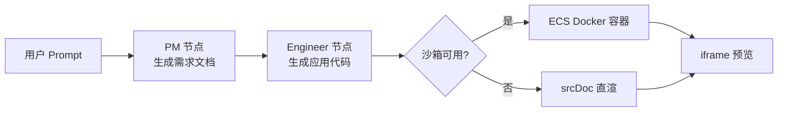
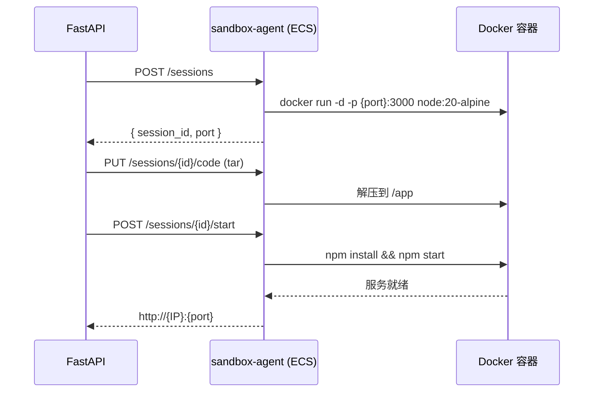

# 构建流水线设计：Prompt → Agent 编排 → 沙箱执行

<div align="center">

[](https://langchain-ai.github.io/langgraph/)
[](https://fastapi.tiangolo.com/)
[]()

**一条从自然语言到可运行应用的标准化流水线**

[状态图设计](#-langgraph-状态图设计) • [Prompt 模板](#-prompt-模板) • [SSE 协议](#-sse-事件协议) • [降级与排障](#-降级策略)

</div>

---

## 📋 目录

- [构建流水线设计：Prompt → Agent 编排 → 沙箱执行](#构建流水线设计prompt--agent-编排--沙箱执行)
  - [📋 目录](#-目录)
  - [🎯 流水线总览](#-流水线总览)
    - [阶段耗时预算（演示预期管理）](#阶段耗时预算演示预期管理)
  - [🧠 LangGraph 状态图设计](#-langgraph-状态图设计)
    - [设计原则：最小状态图](#设计原则最小状态图)
    - [节点职责](#节点职责)
  - [✍️ Prompt 模板](#️-prompt-模板)
    - [PM 节点模板](#pm-节点模板)
    - [Engineer 节点模板](#engineer-节点模板)
    - [代码提取容错](#代码提取容错)
  - [📡 SSE 事件协议](#-sse-事件协议)
    - [事件类型定义](#事件类型定义)
    - [FastAPI 推送实现](#fastapi-推送实现)
    - [前端消费](#前端消费)
  - [📦 沙箱执行流程](#-沙箱执行流程)
  - [🔌 MCP 工具接入（可选）](#-mcp-工具接入可选)
    - [定位](#定位)
    - [降级话术（答辩用）](#降级话术答辩用)
  - [🛡️ 降级策略](#️-降级策略)
  - [🐛 故障排查](#-故障排查)
  - [✅ 检查清单](#-检查清单)

---

## 🎯 流水线总览



### 阶段耗时预算（演示预期管理）

| 阶段 | 预期耗时 | 流式输出 |
|------|:--------:|:--------:|
| PM 需求文档 | 10–20s | ✅ |
| Engineer 代码生成 | 30–90s | ✅ |
| 沙箱启动 + 依赖安装 | 20–60s | ❌（status 事件） |
| **总计** | **1–3 min** | - |

> 💡 **提示**：`npm install` 是最不可控的一环，预热容器与缓存依赖可压到 20s 内。

---

## 🧠 LangGraph 状态图设计

### 设计原则：最小状态图

```python
# graph/state.py
from typing import TypedDict

class BuildState(TypedDict):
    session_id: str
    prompt: str                    # 用户原始需求
    prd: str                       # PM 节点产出
    code: str                      # Engineer 节点产出
    stage: str                     # 当前阶段（pm / engineer / sandbox）
    preview_url: str | None
    error: str | None
```

```python
# graph/builder.py
from langgraph.graph import StateGraph, START, END
from graph.state import BuildState
from graph.nodes import pm_node, engineer_node

def build_graph():
    """最小可用编排：顺序两节点，无条件分支。"""
    builder = StateGraph(BuildState)
    builder.add_node("pm", pm_node)
    builder.add_node("engineer", engineer_node)
    builder.add_edge(START, "pm")
    builder.add_edge("pm", "engineer")
    builder.add_edge("engineer", END)
    return builder.compile()
```

### 节点职责

| 节点 | 职责 | 输出写入 | SSE 事件 |
|------|------|----------|----------|
| `pm_node` | 将模糊需求转为结构化需求文档（≤300 字） | `state["prd"]` | `prd_delta` |
| `engineer_node` | 带 PRD 生成完整可运行代码 | `state["code"]` | `code_delta` |

> ⚠️ **禁止清单**：不用 conditional edges、不用 checkpoint 持久化、不用子图。每个特性都是调试时间黑洞。

---

## ✍️ Prompt 模板

### PM 节点模板

```python
# prompts/pm.py
PM_SYSTEM = """你是一位资深产品经理。将用户的模糊需求转化为一份极简需求文档。

输出要求：
1. 全文不超过 300 字，纯文本，不使用 Markdown 标题
2. 必须包含：核心玩法/功能、交互方式、视觉风格
3. 只做关键决策，不展开细节

示例输出格式：
核心功能：贪吃蛇游戏，方向键控制，吃到食物变长，撞墙或撞自身结束。
交互：键盘上下左右；显示当前分数与最高分（localStorage 持久化）。
视觉：深色背景，霓虹色蛇身，像素风。"""

PM_USER = "用户需求：{prompt}"
```

### Engineer 节点模板

```python
# prompts/engineer.py
ENGINEER_SYSTEM = """你是一位资深前端工程师。根据需求文档生成一个完整可运行的单文件 HTML 应用。

硬性要求：
1. 输出必须是单个 HTML 文件，内联全部 CSS 和 JS，禁止外部依赖
2. 代码放进一个 ```html 代码块中，除此之外不要输出任何解释文字
3. 代码必须可以直接保存为 .html 运行，无控制台报错

软要求：
- 移动端可用；首屏 3 秒内可交互"""

ENGINEER_USER = "需求文档：\n{prd}"
```

> 🔥 **为什么强制单文件 HTML**：零依赖意味着沙箱里不需要 `npm install`，L2 降级（srcDoc）天然兼容。这是「格式约束换系统可靠性」的典型取舍。

### 代码提取容错

```python
import re

def extract_code(raw: str) -> str:
    """从 LLM 输出中提取 html 代码块，带两级容错。"""
    match = re.search(r"```html\s*\n(.*?)```", raw, re.DOTALL)
    if match:
        return match.group(1).strip()
    # 容错：没找到代码块时，去掉首尾非代码行后整体返回
    return raw.strip()
```

---

## 📡 SSE 事件协议

### 事件类型定义

| 事件名 | payload | 触发时机 |
|--------|---------|----------|
| `status` | `{"stage": "pm"}` | 进入 PM 节点 |
| `prd_delta` | `{"text": "..."}` | PM 节点每个 token |
| `status` | `{"stage": "engineer"}` | 进入 Engineer 节点 |
| `code_delta` | `{"text": "..."}` | Engineer 节点每个 token |
| `status` | `{"stage": "sandbox"}` | 开始沙箱部署 |
| `preview_url` | `{"url": "..."}` | 容器启动成功 |
| `error` | `{"message": "..."}` | 任何可恢复错误 |
| `done` | `{}` | 流水线结束 |

### FastAPI 推送实现

```python
# api/builds.py 片段
from sse_starlette.sse import EventSourceResponse

@router.get("/builds/{session_id}/stream")
async def stream_build(session_id: str):
    async def event_generator():
        async for event in run_pipeline(session_id):   # 图执行器产出事件
            yield {
                "event": event.type,                    # prd_delta / code_delta / ...
                "data": json.dumps(event.payload),
            }
    return EventSourceResponse(event_generator())
```

### 前端消费

```typescript
// lib/events.ts
export type BuildEvent =
  | { type: "prd_delta"; text: string }
  | { type: "code_delta"; text: string }
  | { type: "status"; stage: "pm" | "engineer" | "sandbox" }
  | { type: "preview_url"; url: string }
  | { type: "error"; message: string }
  | { type: "done" };

export function parseEvent(raw: MessageEvent): BuildEvent {
  return { type: raw.type as BuildEvent["type"], ...JSON.parse(raw.data) };
}
```

---

## 📦 沙箱执行流程



> 💡 **单文件 HTML 优化路径**：若产出为单 HTML 文件，跳过容器，直接返回 URL 或走 srcDoc——平均节省 40s。

---

## 🔌 MCP 工具接入（可选）

### 定位

MCP 是**加分时段（2:20–3:00）的可选项**，核心链路必须先用普通工具函数打通。

| 形态 | 用途 | 考试建议 |
|------|------|----------|
| 普通工具函数 | sandbox.py 直接 HTTP 调 ECS | ✅ 核心链路用 |
| MCP 工具 | 标准化工具协议，生态互操作 | ⭐ 加分项 |

### 降级话术（答辩用）

> “MCP 的价值在工具生态的标准化。我验证了工具函数的形态，接 MCP 只是换一层传输协议——函数签名不变，client 从直接调用换成 MCP client。”

---

## 🛡️ 降级策略

| 级别 | 触发 | 方案 | 演示价值 |
|:----:|------|------|:--------:|
| L1 | ECS 不通 | `SANDBOX_BASE_URL` → 本地 Docker | 环境变量切换 |
| L2 | Docker 不可用 | srcDoc 直渲单 HTML | 界面开关展示 |
| L3 | LangGraph 异常 | 两次顺序 LLM 调用 | 配置开关 |

> ⚠️ **checkpoint**：`1:50` 核心链路（到 L2 可用）未通，立即砍掉 MCP 与多 Agent 加分项，全部时间回补链路。

---

## 🐛 故障排查

| 现象 | 可能原因 | 解决方案 |
|------|----------|----------|
| SSE 前端收不到流 | Next 转发层缓冲 | 关闭缓冲或用 ReadableStream pipe |
| 代码块解析失败 | LLM 未按格式输出 | `extract_code` 二级容错 + Prompt 强化 |
| 沙箱预览白屏 | 容器内端口未监听 | agent 启动后做 `/health` 轮询再返回 URL |
| iframe 拒绝加载 | `X-Frame-Options` | 预览服务加 `ALLOW-FROM` 或代理转发 |
| `npm install` 超时 | ECS 带宽/源站慢 | 预装依赖镜像 或 强制单文件 HTML 产物 |

---

## ✅ 检查清单

- [ ] 状态图仅两节点 + 顺序边，无过度设计
- [ ] Engineer Prompt 强制单文件 HTML + 代码块提取容错
- [ ] SSE 事件覆盖 status / delta / preview_url / error / done
- [ ] 沙箱 agent 有端口上限与拒绝策略
- [ ] 三级降级均可一键切换

---

<div align="center">

**小步生成，立即验证，永远可演示**

[⬆ 返回顶部](#构建流水线设计prompt--agent-编排--沙箱执行)

**最后更新：2026-11-07**

</div>