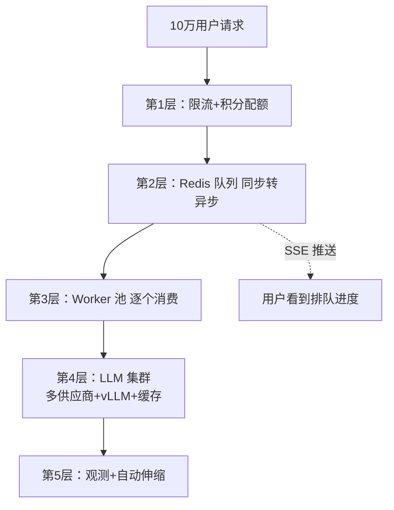

# 高并发与分布式架构设计（1–10 万用户规模）

<div align="center">

[](https://fastapi.tiangolo.com/)
[](https://redis.io/)
[]()

**LLM 生成是「分钟级长任务」，不是普通 HTTP 请求——架构必须围绕这一点设计**

[故障链分析](#-不打理会怎样级联故障链) • [五层方案](#-解决方案五层防御) • [分布式架构](#-分布式架构哪里扩怎么扩)

</div>

---

## 📋 目录

- [高并发与分布式架构设计（1–10 万用户规模）](#高并发与分布式架构设计110-万用户规模)
  - [📋 目录](#-目录)
  - [🎯 核心认知](#-核心认知)
  - [💥 不打理会怎样：级联故障链](#-不打理会怎样级联故障链)
  - [🛡️ 解决方案：五层防御](#️-解决方案五层防御)
    - [分层总览](#分层总览)
    - [第 1 层：入口限流（止血）](#第-1-层入口限流止血)
    - [第 2 层：同步改异步 + 队列（架构核心）](#第-2-层同步改异步--队列架构核心)
    - [第 3 层：LLM 侧削峰](#第-3-层llm-侧削峰)
    - [第 4 层：降配与错峰](#第-4-层降配与错峰)
    - [第 5 层：容量规划与观测](#第-5-层容量规划与观测)
  - [🏗️ 分布式架构：哪里扩、怎么扩](#️-分布式架构哪里扩怎么扩)
    - [两个独立的扩容轴](#两个独立的扩容轴)
    - [扩容决策表](#扩容决策表)
  - [💰 成本账与资源分级](#-成本账与资源分级)
  - [📊 容量规划公式](#-容量规划公式)
  - [🎤 答辩话术](#-答辩话术)
  - [✅ 检查清单](#-检查清单)

---

## 🎯 核心认知

> 🔥 **LLM 生成的本质**：单次请求耗时 1–3 分钟，是「长任务」而非「短请求」。拿同步请求-响应模型去扛高并发，架构上就是错的。

三个关键推论：

1. **入口洪峰 ≠ 处理洪峰**：队列可以接住 10 万提交，后端只需几十个并发消化
2. **应用层不是瓶颈**：无状态随便扩，真正的瓶颈在模型层（GPU）
3. **成本即架构**：10 万用户的生成成本决定必须有积分制做资源分级

---

## 💥 不打理会怎样：级联故障链

```
1-10万并发 → LLM API 限流（429）/ 超时
    → FastAPI worker 全部阻塞在等待 LLM 响应
    → 连接池 / 内存耗尽 → uvicorn worker 崩溃
    → 健康检查失败 → LB 摘除 → 全站 502
    → 用户疯狂重试 → 重试风暴，雪上加霜
```

| 死法 | 原因 |
|------|------|
| **429 风暴** | 提供商按 RPM/TPM 限流；代码若同步重试 = 放大流量 |
| **Worker 耗尽** | 生成一次占 worker 1-3 分钟，1000 并发需要数百 worker，内存先爆 |
| **长连接堆积** | 每个 SSE 连接占 FD 和内存，默认 ulimit 1024 先撞墙 |
| **账单爆炸** | 10 万次生成 ≈ $6,000–24,000/天，先破产 |

---

## 🛡️ 解决方案：五层防御

### 分层总览



### 第 1 层：入口限流（止血）

- **用户级**：积分/配额制（每天 N 次免费生成）
- **全局**：令牌桶控制进入总 QPS，超出排队或友好拒绝
- **体验**：前端显示「前面还有 N 人」，把拒绝变成等待

### 第 2 层：同步改异步 + 队列（架构核心）

```
改之前（错误）：
用户请求 → FastAPI → 同步等 LLM 3分钟 → 返回（worker 被占死）

改之后（正确）：
用户请求 → FastAPI → 写入 Redis 队列 → 立即返回 { job_id }
                      │
          Worker 池（10-50个）从队列取任务逐个执行
                      │
          完成后 → 写结果 → SSE/WebSocket 推送通知用户
```

- 队列：**Redis + Celery/RQ/BullMQ**，量大上 Kafka
- 用户感知不变：SSE 通道已存在，「排队中」只是多一个状态事件
- scaffold 改造点：流水线前插一个队列生产者，worker 消费原流水线

### 第 3 层：LLM 侧削峰

- **多供应商池**：OpenAI / Anthropic / 国产模型做 fallback，一家 429 自动切下家
- **流式输出**：降低首 token 延迟（用户感知），缩短单连接占用
- **语义缓存**（GPTCache）：热门 prompt（如「贪吃蛇」）直接命中，零 LLM 成本
- **模型分级**：高峰期免费用户走 7B 小模型（自托管，成本 1/10），付费走大模型

### 第 4 层：降配与错峰

| 手段 | 效果 |
|------|------|
| 模板预生成 | 热门类型套模板，只填数据 |
| 定时任务夜间批处理 | 错峰执行 |
| GPU 闲时释放 | 缩容与扩容同样重要 |

### 第 5 层：容量规划与观测

监控四件套：**队列深度 / 首 token 延迟 / LLM 错误率 / token 成本/用户**

---

## 🏗️ 分布式架构：哪里扩、怎么扩

### 两个独立的扩容轴

**轴 1：应用层（无状态，便宜随便扩）**

```text
        负载均衡（Nginx/ALB）
       /          |           \
   Node 1      Node 2      Node 3      ← FastAPI 实例，复制即扩容
       \          |           /
        Redis（队列+缓存）   Postgres（数据）
```

- 加节点 = 复制粘贴，K8s HPA 按 CPU/内存自动伸缩
- **注意：应用层扩再多也救不了 LLM 瓶颈**，3-10 个节点通常足够

**轴 2：模型层（有状态 GPU，贵的重点）**

```text
                 推理 LB
        /          |          \
   vLLM 实例1  vLLM 实例2  vLLM 实例3
   (8×A100)   (8×A100)   (8×A100)
        \          |          /
        共享前缀缓存（Redis）
```

- **单卡能力**：vLLM continuous batching 下，一张 A100 单实例可同时处理 20–50 个生成请求（GPU 利用率 90%+）
- **多实例**：挂 LB 后水平扩，配合共享前缀缓存提升命中率
- **自动伸缩**：用**队列深度**做信号（KEDA），排队超阈值加 GPU 实例，闲时释放

### 扩容决策表

| 层 | 是否多节点 | 怎么扩 | 瓶颈性质 |
|----|:--------:|--------|----------|
| Next.js 前端 | ✅ 容易 | CDN / 静态托管 | 几乎无瓶颈 |
| FastAPI 应用 | ✅ 容易 | 无状态水平扩 + HPA | 不是瓶颈 |
| Redis 队列/缓存 | ✅ 一主多从 | 哨兵/集群 | 高可用 |
| 数据库 | ✅ 读写分离 | 主从 + 分库分表 | 中期瓶颈 |
| **LLM 推理** | ⚠️ 贵 | vLLM 多实例 + GPU 池 + 队列驱动伸缩 | **真正的瓶颈** |

> 💡 为什么 scaffold 数据层用 SQLite mock：它注定被 Postgres + Redis 替换，但接口不变——**把「会变贵的层」和「随便扩的层」分开设计**，是这类系统最重要的架构直觉。

---

## 💰 成本账与资源分级

```
单次生成 ≈ 输入 2K + 输出 4K tokens ≈ \$0.02-0.08
10万用户 × 3次/天 = 30万次/天 ≈ $6,000-24,000/天
```

**积分制的本质是资源分级**：

| 用户 | 模型 | 队列优先级 |
|------|------|:--------:|
| 免费 | 自托管 7B 小模型（成本 1/10） | 低 |
| 付费 | 大模型 API / 大参数自托管 | 高 |

---

## 📊 容量规划公式

```text
系统吞吐上限 = Worker 数 × (60 / 平均生成分钟数)

例：50 worker × (60 / 2分钟) = 每分钟最多消化 25 个任务
→ 超出的全部进队列排队，这是硬上限
→ 扩 Worker 不如扩 LLM 吞吐（加 GPU / 换小模型）
```

---

## 🎤 答辩话术

> “10 万并发生成请求的本质是**分钟级长任务洪峰**。我的方案三层：**入口积分限流挡住洪峰 → Redis 队列把同步压成异步、worker 池消化 → LLM 侧多供应商 + vLLM 集群 + 语义缓存削峰**。核心指标是队列深度和首 token 延迟，用户感知只是『排队 N 分钟』而非系统崩溃。应用层无状态随便扩，真正的分布式挑战在模型层——vLLM continuous batching 榨干单节点，队列深度驱动 GPU 自动伸缩，**扩容是技术，缩容是成本**，所以必须配积分制做资源分级。”

---

## ✅ 检查清单

- [ ] 所有 LLM 调用入口有配额/限流保护
- [ ] 同步调用已改造为「队列 + worker + SSE 推送」
- [ ] 有 LLM 供应商 fallback 池
- [ ] 有语义缓存或模板缓存覆盖热门请求
- [ ] 监控覆盖：队列深度 / 首 token 延迟 / 错误率 / 成本
- [ ] 伸缩策略含缩容（GPU 按队列深度释放）

---

<div align="center">

**入口挡洪峰，队列化同步，GPU 精打细算，成本决定架构**

[⬆ 返回顶部](#高并发与分布式架构设计110-万用户规模)

</div>